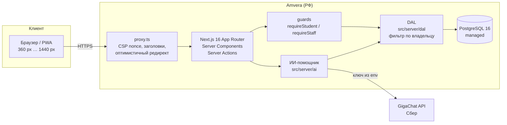
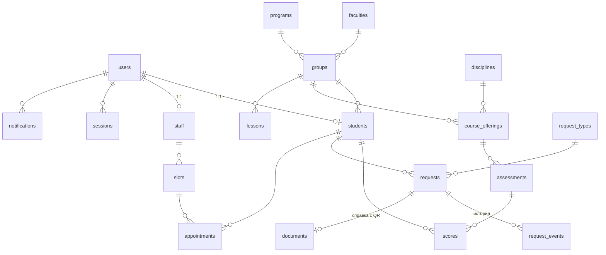

# Архитектура «Меридиана»

## Схема

## Слои
| Слой | Где | Ответственность |
|---|---|---|
| Маршруты и UI | `src/app/(auth)`, `(student)`, `(staff)/staff`, `verify`, `api` | Страницы (Server Components по умолчанию), Server Actions, route handlers |
| Компоненты | `src/components` | UI-кит (`ui/`), оболочка (`shell/`), разделы |
| Авторизация | `src/server/auth` | Пароли, сессии, лимиты, guards |
| Данные | `src/server/dal` | Единственное место запросов к данным пользователя |
| Домен | `src/lib/brs.ts`, `src/lib/time.ts`, `src/server/documents.ts` | БРС-калькулятор, московское время, тексты справок |
| ИИ | `src/server/ai` | Положение (RAG по TF-IDF), контекст студента, GigaChat, офлайн-режим |
| БД | `src/server/db/schema.ts`, `drizzle/` | Схема, миграции |
| Сид | `src/server/seed` | Вымышленные данные «относительно сегодня» |

## Модель данных (основное)

25 таблиц; индексы на всех внешних ключах и полях фильтрации (`requests(student_id, created_at)`, `requests(status, created_at)`, `lessons(group_id, starts_at)`, частичный индекс непрочитанных уведомлений и др.).

## Ключевые решения
- **Stateless-сервер.** Сессии и счётчики лимитов — в PostgreSQL, поэтому приложение можно запустить в N экземплярах за балансировщиком.
- **Динамический рендер персональных страниц** (`cacheComponents` выключен, D-013): исключён риск закешировать данные одного студента и показать другому.
- **Веерная рассылка уведомлений** одним `INSERT … SELECT` (объявления, переносы) — тысячи адресатов за один запрос.
- **Курсорная пагинация** ленты уведомлений; очередь деканата — постранично с сортировкой по сроку.
- **Время — всегда Москва** (`src/lib/time.ts`), сервер может жить в UTC.
- **Уведомления «созревают»:** у напоминаний время появления может быть в будущем; лента показывает `created_at ≤ сейчас`. Демо выглядит живым все три недели проверки без пересоздания данных.
- **Миграции и первичный сид — при старте контейнера** (`src/instrumentation.ts` → `src/server/startup.ts`).

## Масштабирование (если бы это был реальный сервис)
| Нагрузка | Решение |
|---|---|
| 10 000 студентов, пики в сессию | 2–4 реплики приложения, пул соединений pgBouncer, read-replica для чтения расписания |
| Рассылки на весь вуз | Очередь (например, отдельный воркер) вместо синхронного INSERT … SELECT |
| Интеграции с вузом | Расписание и оценки — импорт из учебной системы по API; вход — через единую учётную запись вуза (SSO) |
| Push на телефон | Web Push (VAPID) поверх существующих уведомлений |

## Запуск
См. `README.md` и `AGENTS.md` (раздел «Команды»). Production: `Dockerfile` (multi-stage, `output: standalone`), `amvera.yml`.
