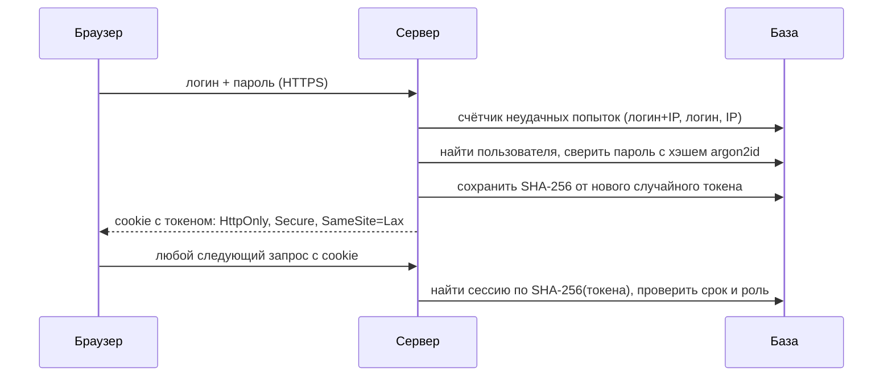

# Безопасность «Меридиана» — простыми словами

> Для жюри: как устроены вход, хранение данных и защита, и как это проверить самим за 2 минуты.
> Техническая часть — в конце. Независимый аудит — `docs/prompts/10-security-audit.md` и раздел «Этап 10» в `PROCESS_LOG.md`.

## Главное за 30 секунд
1. **Каждый студент видит только своё.** Сервер определяет «кто вы» только по сессии — не по номеру в адресной строке. Подставьте в адрес чужую заявку — получите «Страница не найдена» (404), такой же ответ, как для несуществующей.
2. **Пароли не хранятся.** В базе лежит только «отпечаток» пароля (хэш argon2id). Даже администратор БД не узнает пароль.
3. **Ключ ИИ и пароль базы — только на сервере**, в переменных окружения хостинга. В коде и в браузере их нет — это проверяет скрипт `npm run check:bundle` на каждой сборке.
4. **Все данные вымышлены.** Реальных студентов, преподавателей и оценок нет.

## Как это проверить самим
| Что проверить | Как |
|---|---|
| Чужая заявка не открывается | Войдите как `sokolova`, откройте любую заявку и скопируйте адрес. Выйдите, войдите как `galiev`, вставьте адрес → «Страница не найдена» |
| Чужой документ не открывается | То же с адресом `…/document` выданной справки |
| Студент не попадает к деканату | Под студентом откройте `/staff` → вас вернёт на главную |
| Выход действительно выходит | После «Выйти» старая сессия удаляется из базы — кнопка «Назад» в браузере не вернёт в кабинет |
| Перебор паролей блокируется | 5 неверных паролей подряд → «Слишком много неудачных попыток» |
| Справку нельзя подделать | QR-код ведёт на страницу проверки с данными из базы; изменённый код → «Документ не найден» |

## Как устроен вход

- Токен — 32 случайных байта. В базе — только его хэш: утечка базы не даёт войти чужими сессиями.
- Сессия живёт 7 дней без активности и не дольше 30 дней от входа. «Выйти» удаляет запись — токен становится бесполезным. В профиле видны активные устройства.
- Ошибка входа всегда одна: «Неверный логин или пароль» — по ней нельзя понять, существует ли логин. Для несуществующего логина сервер тратит столько же времени (хэш-заглушка).
- Лимиты: 5 неудач на пару «логин + IP», 20 на логин со всех адресов, 30 с одного адреса за 15 минут. Счётчики в БД — работают при нескольких серверах.

## Как хранятся и защищаются данные
- **Слой доступа к данным (DAL).** Весь код, который читает данные студента, лежит в `src/server/dal`. Каждая функция получает «зрителя» из сессии и добавляет условие `student_id = <из сессии>`. Страница просто не может попросить «заявку №…» без этого условия.
- **Роли проверяются на сервере дважды:** в разметке раздела и в каждом действии (кнопке), потому что действие можно вызвать и в обход страницы.
- **Публичная проверка справки** показывает минимум: вид документа, номер, дату и ФИО в виде «Соколова А. В.». Код в QR — 96 случайных бит, не номер записи: перебрать невозможно.
- **ИИ-помощник** получает только данные текущего студента и вымышленное Положение. Он **ничего не делает сам**: максимум — открывает форму заявки с подставленными полями, а отправляет её студент. Лимит — 30 вопросов в час.
- **Офлайн-режим** не хранит личные страницы на устройстве: на общем компьютере после выхода никто не увидит чужие данные.

## Технические меры (чек-лист)
| Мера | Где |
|---|---|
| argon2id m=19 МиБ, t=2, p=1 (OWASP) | `src/server/auth/password.ts` |
| Сессии в БД, токен 256 бит, SHA-256, скользящий срок | `src/server/auth/session.ts` |
| Rate limiting в БД, IP от доверенного прокси (`TRUSTED_PROXY_HOPS`) | `src/server/auth/rate-limit.ts`, `login/actions.ts` |
| Guards `requireStudent` / `requireStaff` / `apiViewer` | `src/server/auth/guards.ts` |
| Фильтр по владельцу во всех запросах | `src/server/dal/*.ts` |
| 404 вместо 403 для чужих объектов | `notFound()` в страницах и действиях |
| CSP с nonce + `strict-dynamic`, `frame-ancestors 'none'`, XFO, nosniff, HSTS, Referrer-Policy, Permissions-Policy, COOP/CORP | `src/proxy.ts`, `next.config.ts` |
| Проверка Origin для изменяющих запросов (CSRF) | Server Actions (встроено в Next) + `assertSameOrigin` |
| Защита от open redirect параметра `next` | `safeNext()` в `login/actions.ts` |
| zod-валидация всех входов, лимиты длины | actions, `/api/*`, DAL |
| Секреты только в env, `server-only`, проверка сборки | `src/server/env.ts`, `scripts/check-bundle.mjs` |
| Только параметризованные SQL-запросы (Drizzle) | весь `src/server` |
| `Cache-Control: private, no-store` для персональных ответов | динамический рендер, `/api/*` |

## Автотесты безопасности
- `tests/e2e/isolation.spec.ts` — чужая заявка/документ → 404, оценки/профиль/расписание только свои, `.ics` только своё и требует вход, студент не попадает в `/staff`, API помощника: 401 без входа и 403 с чужого Origin, logout аннулирует cookie.
- `tests/e2e/auth.spec.ts` — единая ошибка входа, блокировка перебора, заголовки безопасности.
- `tests/unit/dal-isolation.test.ts` — на уровне БД: чужую заявку не прочитать, не ответить, не отозвать; чужое уведомление не отметить; чужую запись не отменить; ВУЦ и языковые подгруппы; в БД только argon2id-хэши.

## Известные ограничения прототипа (честно)
- Пароли демо-аккаунтов опубликованы для жюри (на странице входа и в `TEST_ACCOUNTS.md`). В реальном сервисе вход был бы через единую учётную запись вуза.
- Сброс демо-данных доступен сотруднику не чаще раза в 30 минут; при сбросе все сессии завершаются.
- Встроенные `style`-атрибуты разрешены в CSP (`style-src 'unsafe-inline'`) — они не исполняют код; скрипты строго по nonce.
